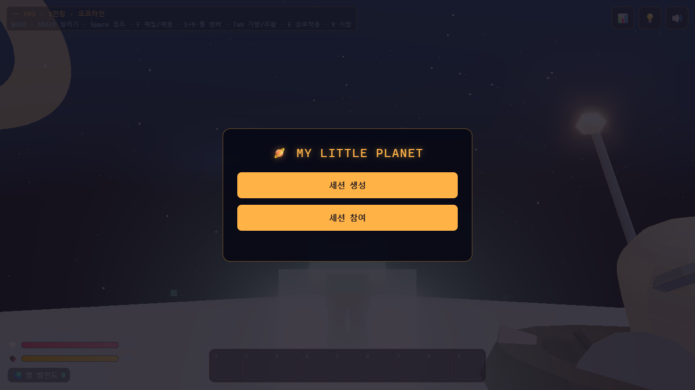
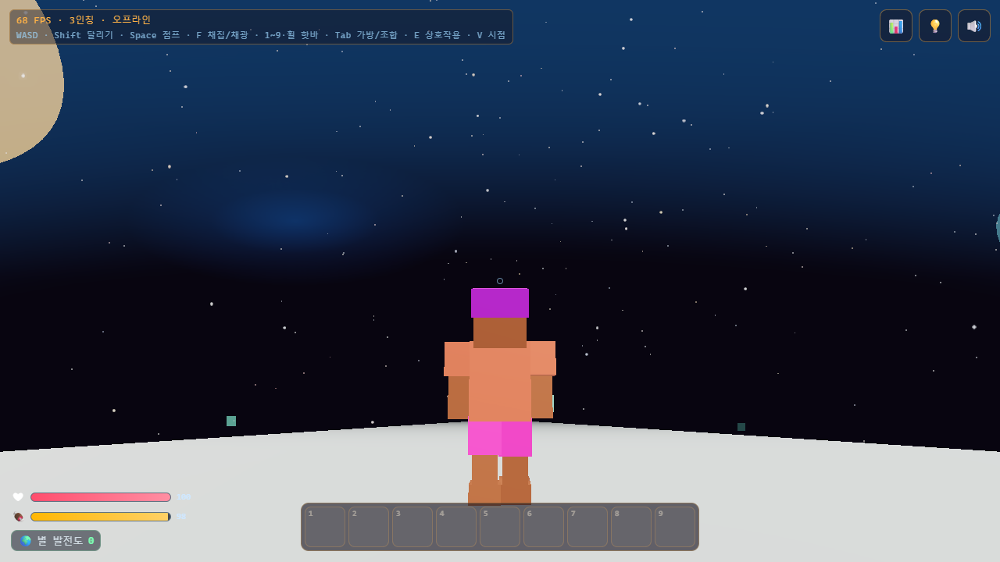

# My Little Planet

캐주얼 사이버펑크 톤의 **작은 행성 허브 월드**를 돌아다니며, 행성에 놓인 기계로 여러 장르의 미니게임(FPS · 레이싱 · 슈팅 · 점프맵)을 즐기는 웹 3D 게임.

## 플레이

- **브라우저에서 바로**: https://parkrye.github.io/WebProject_MyLittlePlanet/ (PC · 모바일, WebGL 필요)
- **내려받아 오프라인으로 (Windows)**: [Releases](../../releases)에서 `MyLittlePlanet-<버전>-windows.zip`을 받아 압축을 풀고 `play.bat` 실행. 브라우저가 열리고, 검은 창을 닫으면 종료

배포판은 혼자 플레이. 진행은 브라우저에 저장되고 "저장된 세션 불러오기"로 이어서 한다.

## 게임

- 한 방향으로 쭉 가면 제자리로 돌아오는 구형 행성을 1 · 3인칭으로 탐험
- 행성 주위를 떠도는 쓰레기를 그물로 포획 · 채집 · 채광하고, 가방에서 조합해 행성에 설치
- 설치한 기계에 다가가 상호작용하면 미니게임 진입 — 점프맵 · 레이싱(AI 3대와 3랩) · 탑뷰 탄막 슈팅 · FPS
- 체력 · 허기를 관리하며 별 발전도를 올린다

## 조작

| 입력 | 동작 |
|---|---|
| WASD · 마우스 | 이동 · 시점 |
| Shift | 달리기 |
| Space | 점프 |
| F | 채집 · 채광 |
| 1~9 · 휠 | 핫바 |
| Tab | 가방 · 조합 |
| E | 상호작용 (미니게임 진입) |
| V | 1 · 3인칭 전환 |

모바일은 왼쪽 가상 조이스틱으로 이동, 오른쪽 드래그로 시점, 화면 버튼으로 점프 · 상호작용.

## 문의

버그 · 제안은 [Issues](../../issues)에.
